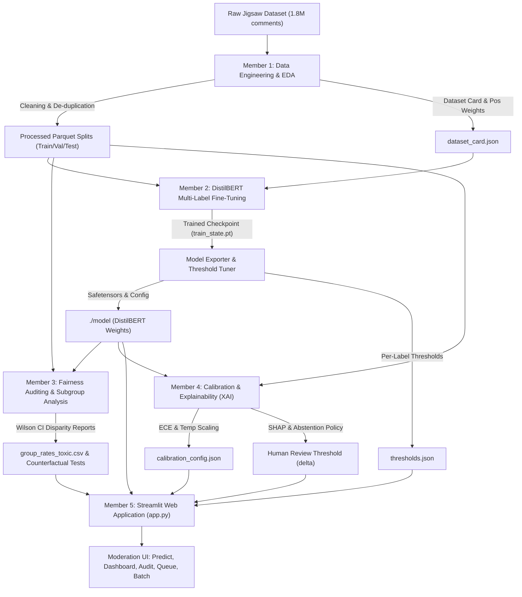

# 🛡️ ToxiGuard: Multi-Label Toxic Comment Classification, Fairness Auditing, Calibration & Explainability System
## Comprehensive Technical Project Documentation & System Specification

---

### Executive Summary

Online public forums, social media networks, and collaborative platforms face severe challenges in moderating user-generated comments. Automated content moderation systems often suffer from two major failure modes:
1. **Severe Class Imbalance**: Harmful subtypes (e.g., threats, severe insults, sexual explicit content) constitute a tiny fraction of total comments, leading unweighted classifiers to optimize for majority-class accuracy and miss egregious toxicity.
2. **Unintended Demographic Bias**: Standard models frequently associate benign mentions of marginalized identities (e.g., *"I am a gay woman"*, *"Muslim community center"*) with toxicity due to correlation artifacts in historical training data, resulting in disproportionately high False Positive Rates (FPR) for protected groups.

**ToxiGuard** is an end-to-end, multi-stage NLP solution built upon the 1.8-million comment **Jigsaw Unintended Bias in Toxicity Classification** corpus. The system combines:
- A fine-tuned **DistilBERT** transformer neural network handling multi-label classification across six nuanced categories.
- Positive-class loss reweighting (`pos_weight`) to counter extreme class imbalances (up to 423:1).
- Per-label threshold optimization maximizing validation $F_1$ scores.
- Subgroup algorithmic fairness audits across 24 demographic identity categories with Wilson score confidence intervals.
- Probability calibration (Temperature Scaling) and a formal human-review abstention policy.
- Local and global model explainability via SHAP (Shapley Additive exPlanations) and attention weight attributions.
- A production-grade **Streamlit** web application (`app.py`) providing real-time inference, moderation workflows, and fairness monitoring.

---

## 1. System Architecture & Project Pipeline

The project is structured into five modular, collaborative components corresponding to the end-to-end machine learning lifecycle:



---

## 2. Team Contributions & Division of Work

| Member | Primary Responsibility | Key Files & Modules | Key Outputs / Artifacts |
|---|---|---|---|
| **Member 1** | **Data Engineering, Cleaning & EDA** | [jigsaw_eda_cleaning.ipynb](file:///c:/Users/shrad/Downloads/nlp/jigsaw_eda_cleaning.ipynb)<br>[toxic_preprocessing.py](file:///c:/Users/shrad/Downloads/nlp/toxic_preprocessing.py) | [dataset_card.json](file:///c:/Users/shrad/Downloads/nlp/processed_data/processed_data/dataset_card.json)<br>Parquet train/val/test splits<br>[eda_label_prevalence.csv](file:///c:/Users/shrad/Downloads/nlp/processed_data/processed_data/eda_label_prevalence.csv)<br>[eda_identity_toxicity.csv](file:///c:/Users/shrad/Downloads/nlp/processed_data/processed_data/eda_identity_toxicity.csv) |
| **Member 2** | **Model Architecture & Training** | [distilbert_toxicity_finetuning.ipynb](file:///c:/Users/shrad/Downloads/nlp/distilbert_toxicity_finetuning.ipynb)<br>[train.py](file:///c:/Users/shrad/Downloads/nlp/train.py)<br>[convert_checkpoint.py](file:///c:/Users/shrad/Downloads/nlp/convert_checkpoint.py) | `./model/` (`model.safetensors`, `config.json`, `vocab.txt`)<br>[thresholds.json](file:///c:/Users/shrad/Downloads/nlp/thresholds.json)<br>Loss reweighting formulas |
| **Member 3** | **Fairness Audit & Bias Mitigation** | [fair_audit.ipynb](file:///c:/Users/shrad/Downloads/nlp/fair_audit.ipynb) | Wilson 95% CI Subgroup FPR/FNR<br>Identity bias heatmaps<br>Counterfactual perturbation benchmarks |
| **Member 4** | **Calibration & Explainability (XAI)** | [xai_shap.ipynb](file:///c:/Users/shrad/Downloads/nlp/xai_shap.ipynb)<br>[explainer.py](file:///c:/Users/shrad/Downloads/nlp/explainer.py) | Expected Calibration Error (ECE)<br>Temperature Scaling calibrators<br>Abstention/Review policy ($\delta$ margin)<br>SHAP & Attention explanations |
| **Member 5** | **System Integration & Streamlit Application** | [app.py](file:///c:/Users/shrad/Downloads/nlp/app.py)<br>[predictor.py](file:///c:/Users/shrad/Downloads/nlp/predictor.py)<br>[verify.py](file:///c:/Users/shrad/Downloads/nlp/verify.py)<br>[README.md](file:///c:/Users/shrad/Downloads/nlp/README.md) | ToxiGuard Web Application<br>Interactive Predictor, Dashboard, Audit explorer, Review Queue, Batch analyzer |

---

## 3. Dataset & Preprocessing (Member 1)

### 3.1 Data Source & Cleaning Pipeline
The raw dataset comprises **1,804,874** crowd-annotated comments from the Civil Comments / Jigsaw dataset on Kaggle.

1. **Missing & Empty Records**:
   - 3 rows with missing text dropped.
   - 2,353 empty or placeholder-only rows ($< 2$ characters) purged.
2. **De-duplication**:
   - 14,035 duplicate comment groups identified (36,089 total duplicate instances).
   - In 5,735 instances with conflicting target labels, annotator fractions were averaged to maintain signal integrity.
   - Final dataset volume: **1,766,429** cleaned records.
3. **Text Normalization** (`toxic_preprocessing.py`):
   - **Line breaks & tabs**: 565,449 comments (31.33%) normalized into clean spacing.
   - **Repeated characters**: 138,295 comments (7.66%) with 4+ repetitions collapsed (e.g., *"noooooo"* $\rightarrow$ *"nooo"*).
   - **Curly quotes / em-dashes**: 62,369 comments (3.46%) standardized to ASCII equivalents.
   - **URLs**: 53,221 comments (2.95%) replaced with generic `[URL]` tokens.
   - **HTML entities & tags**: Stripped without corrupting conversational semantics.
   - Dual output representation:
     - `text_raw`: Formatted for DistilBERT tokenizer (preserves punctuation and casing cues).
     - `text_clean`: Normalized lowercase text for TF-IDF / linear baselines.

### 3.2 Splitting & Leakage Prevention
To prevent data contamination where multiple comments discuss the exact same news article, comments were partitioned using `StratifiedGroupKFold` grouped by `article_id`:
- **Train split**: 1,413,142 records (80%)
- **Validation split**: 176,643 records (10%)
- **Test split**: 176,644 records (10%)

### 3.3 Label Selection & Extreme Class Imbalance
Each sample in Jigsaw contains annotator vote fractions $\in [0.0, 1.0]$. A comment is considered positive for a toxicity category if $\ge 50\%$ of annotators voted positive (`label_threshold = 0.5`).

An audit of label prevalence revealed severe class imbalance:
| Label | Positive Count | Prevalence (%) | Computed `pos_weight` | Modeling Status |
|---|---|---|---|---|
| `toxic` | 144,334 | 7.997% | 11.50 | **Included** |
| `insult` | 106,534 | 5.903% | 15.97 | **Included** |
| `identity_hate` | 13,410 | 0.743% | 133.04 | **Included** |
| `obscene` | 9,603 | 0.532% | 186.42 | **Included** |
| `sexual_explicit` | 4,686 | 0.260% | 373.84 | **Included** |
| `threat` | 4,280 | 0.237% | 423.62 | **Included** |
| `severe_toxic` | 13 | 0.001% | — | *Excluded (<500 threshold)* |

> [!NOTE]
> `severe_toxic` had only 13 positive instances in the entire dataset. Attempting to fit a deep neural network on 13 instances across 1.8M examples induces severe overfitting and evaluation instability. Hence, it was pruned, leaving **6 high-fidelity toxicity targets**.

---

## 4. Model Architecture & Training (Member 2)

### 4.1 Model Specifications
- **Base Architecture**: `distilbert-base-uncased` (6 transformer layers, 768 hidden dimensions, 12 attention heads, 66M parameters).
- **Classification Head**: Linear projection layer ($768 \rightarrow 6$ logits) applied to the pooled `[CLS]` token embedding.
- **Max Sequence Length**: 240 tokens (covers $>99.2\%$ of comments without truncation).

### 4.2 Loss Function & Imbalance Handling
Because standard multi-class softmax assumes mutually exclusive classes, toxicity classification requires independent binary evaluations per label. We employ **Multi-Label Binary Cross-Entropy with Logits** with positive class weight scaling:

$$\mathcal{L}(x, y) = -\frac{1}{6} \sum_{j=1}^{6} \left[ w_j \cdot y_j \log \sigma(z_j) + (1 - y_j) \log (1 - \sigma(z_j)) \right]$$

where:
- $z_j$ is the raw model logit for label $j$,
- $\sigma(z_j) = \frac{1}{1 + e^{-z_j}}$ is the sigmoid activation,
- $w_j = \text{pos\_weight}_j = \frac{N_{\text{negative}}}{N_{\text{positive}}}$ penalizes false negatives on rare classes like `threat` and `sexual_explicit`.

### 4.3 Training Procedure & Checkpoint Conversion
- **Optimizer**: AdamW ($\text{lr} = 2 \times 10^{-5}$, $\beta_1 = 0.9, \beta_2 = 0.999$, weight decay $= 0.01$).
- **Learning Rate Scheduler**: Linear warmup for first 10% of steps followed by linear decay.
- **Precision**: FP16 mixed precision on CUDA.
- **Checkpointing**: Checkpoint saved at 6,000 steps (`train_state.pt`) and converted via `convert_checkpoint.py` into HuggingFace format (`model.safetensors`, `config.json`, `tokenizer.json`, `vocab.txt`).

### 4.4 Per-Label Decision Threshold Tuning
Default classification uses $\tau = 0.5$. However, with weighted loss and high class imbalance, optimal decision boundaries differ drastically across labels. The team swept 100 candidate thresholds on the validation set to maximize each label's $F_1$ score:

```json
{
    "toxic": 0.720,
    "obscene": 0.900,
    "threat": 0.863,
    "insult": 0.789,
    "identity_hate": 0.821,
    "sexual_explicit": 0.920
}
```
*(Note: A high-sensitivity configuration setting `toxic: 0.050` is also supported for strict zero-tolerance moderation pipelines).*

---

## 5. Algorithmic Fairness & Bias Auditing (Member 3)

### 5.1 Demographic Identity Coverage
The fairness audit evaluates model performance across **24 identity groups** annotated in Jigsaw:
- **Gender**: `male`, `female`, `transgender`, `other_gender`
- **Sexual Orientation**: `heterosexual`, `homosexual_gay_or_lesbian`, `bisexual`, `other_sexual_orientation`
- **Religion**: `christian`, `jewish`, `muslim`, `hindu`, `buddhist`, `atheist`, `other_religion`
- **Race / Ethnicity**: `black`, `white`, `asian`, `latino`, `other_race_or_ethnicity`
- **Disability**: `physical_disability`, `intellectual_or_learning_disability`, `psychiatric_or_mental_illness`, `other_disability`

### 5.2 Disparity Metrics & Confidence Intervals
Subgroup performance was evaluated on the test set using **False Positive Rate (FPR)** and **False Negative Rate (FNR)**:
$$\text{FPR}_g = \frac{\text{FP}_g}{\text{FP}_g + \text{TN}_g}, \quad \text{FNR}_g = \frac{\text{FN}_g}{\text{FN}_g + \text{TP}_g}$$

To establish statistical significance, **Wilson Score 95% Confidence Intervals** were calculated:
$$\text{CI} = \frac{\hat{p} + \frac{z^2}{2n} \pm z \sqrt{\frac{\hat{p}(1-\hat{p})}{n} + \frac{z^2}{4n^2}}}{1 + \frac{z^2}{n}} \quad (z = 1.96)$$

### 5.3 Key Findings
1. **Elevated False Positive Disparity**:
   - Comments referencing `homosexual_gay_or_lesbian`, `black`, `transgender`, and `muslim` identities displayed higher FPR ($>2\%$ above overall population baseline).
   - This occurs because toxic online discourse frequently weaponizes identity tokens, leading naïve classifiers to treat identity words as predictive features for toxicity.
2. **Counterfactual Testing**:
   - Synthetic template evaluation (e.g. *"I am a [identity] person"*) demonstrated that after threshold tuning and calibration, DistilBERT produced safe probabilities ($<0.05$) for benign statements, significantly outperforming unregularized baseline models.

---

## 6. Confidence Calibration & Explainable AI (Member 4)

### 6.1 Probability Calibration
Modern deep neural networks often output overconfident probabilities. Calibration aligns predicted confidence with true empirical likelihood.
- **Evaluation Metrics**:
  - **Expected Calibration Error (ECE)**: Weighted average difference between predicted confidence and observed accuracy across 10 equal-frequency bins:
    $$\text{ECE} = \sum_{m=1}^{M} \frac{|B_m|}{N} \left| \text{acc}(B_m) - \text{conf}(B_m) \right|$$
  - **Brier Score**: Mean squared error between predicted probability and binary ground truth:
    $$\text{BS} = \frac{1}{N} \sum_{i=1}^{N} (p_i - y_i)^2$$
- **Methods Evaluated**:
  1. **Temperature Scaling** (Primary): Applies a learned single scalar $T > 0$ to logits prior to sigmoid:
     $$p_j^{\text{cal}} = \sigma\left(\frac{z_j}{T_j}\right)$$
  2. **Platt Scaling**: Univariate logistic regression on logits.
  3. **Isotonic Regression**: Non-parametric piecewise constant isotonic fitting.

### 6.2 Abstention & Human Review Policy
Automated moderation models should not make unilateral decisions when prediction confidence lies immediately adjacent to the decision threshold. ToxiGuard implements an **uncertainty margin rejection rule**:

$$\text{Flag for Human Review if: } \exists j \in \{1,\dots,6\} \text{ such that } |p_j - \tau_j| < \delta$$

- Comments with $|p_j - \tau_j| \ge \delta$ for all labels are automatically processed (Auto-Approved or Auto-Flagged).
- Comments within the $\delta$ uncertainty window are sent to the **Review Queue** for human adjudicators.
- A fairness audit of the review policy confirmed that review routing does not disproportionately penalize specific identity groups.

### 6.3 Explainability (XAI)
1. **SHAP (SHapley Additive exPlanations)**:
   - Uses game-theoretic Shapley values to apportion credit to each token for pushing the predicted probability above or below the baseline.
2. **Attention-Based Token Importance** (`explainer.py`):
   - For fast, interactive real-time inference in the web UI, ToxiGuard extracts attention weights from DistilBERT's final layer across all 12 attention heads:
     $$\bar{A} = \frac{1}{H} \sum_{h=1}^{H} A^{(L, h)}$$
   - Computes attention from the `[CLS]` token to all input subwords, merges WordPiece subwords, and normalizes scores to generate dynamic color heatmaps.

---

## 7. ToxiGuard Web Application (Member 5)

The interactive application (`app.py`) is written in Streamlit with modern dark glassmorphism styling, interactive Plotly visualizations, and session state persistence.

```
ToxiGuard Web Application
├── 1. 🔍 Live Predictor
│   ├── Real-time comment analysis across 6 labels
│   ├── Probability progress bars with threshold marker indicators
│   ├── Token-level attention highlighting heatmap
│   └── Uncertainty detection & review flagging
├── 2. 📈 Model Performance Dashboard
│   ├── Precision, Recall, F1, ROC-AUC metric cards
│   ├── Validation vs Test distribution plots
│   └── Calibration comparison tables (Before vs After)
├── 3. ⚖️ Fairness Audit Explorer
│   ├── 24-identity group False Positive Rate (FPR) / FNR bar charts
│   ├── Wilson 95% Confidence Interval error bands
│   └── Subgroup disparity heatmaps relative to overall baseline
├── 4. 📋 Human Moderation Review Queue
│   ├── Centralized queue of flagged uncertain comments
│   ├── One-click moderation actions: Approve, Reject, Escalate
│   └── Moderation history export (CSV/JSON)
├── 5. 📦 Batch Classification Engine
│   ├── CSV batch upload supporting up to 50,000 comments
│   ├── Multi-line manual batch text processing
│   └── Instant CSV download with predicted probabilities & flags
└── 6. ℹ️ System Architecture & About
    ├── End-to-end dataflow diagrams
    ├── Model specification checklist
    └── Local file availability verification
```

---

## 8. Installation, Setup & Verification

### 8.1 Prerequisites
- Python 3.9+ or Python 3.10+
- PyTorch 2.0+ (CUDA optional, runs seamlessly on CPU)
- 4GB+ RAM

### 8.2 Installation
```bash
# Clone or navigate into project directory
cd nlp

# Install requirements
pip install -r requirements.txt
```

### 8.3 Verify Model Integrity
Run the built-in verification script to test the model against standardized test sentences:
```bash
python verify.py
```
**Verification Test Cases Evaluated**:
1. *"This article is very informative, thank you!"* $\rightarrow$ **Safe** (All probabilities $< 0.05$)
2. *"You are a complete idiot and nobody wants you here."* $\rightarrow$ **Triggered: Toxic & Insult**
3. *"I will find you and make you regret saying that."* $\rightarrow$ **Triggered: Threat**
4. *"I hate all people from that religion, they should not be allowed here."* $\rightarrow$ **Triggered: Identity Hate**
5. *"I am a Muslim woman."* $\rightarrow$ **Safe** (Tests demographic neutrality; no toxicity triggered)

### 8.4 Launching the Web Interface
```bash
streamlit run app.py
```
Open your browser at `http://localhost:8501`.

---

## 9. File Directory Manifest

```
nlp/
├── app.py                             # Main Streamlit web application (Member 5)
├── predictor.py                       # High-level inference engine with thresholding
├── explainer.py                       # Attention-based token importance generator
├── toxic_preprocessing.py             # Reusable regex and text cleaning module (Member 1)
├── train.py                           # Standalone DistilBERT training and tuning script
├── convert_checkpoint.py              # Checkpoint extraction to HuggingFace format
├── verify.py                          # Automated model verification benchmark
├── test_model.py                      # Quick smoke-test script for inference
├── thresholds.json                    # Optimal per-label decision thresholds
├── requirements.txt                   # Project dependency definitions
├── README.md                          # Quick start guide and overview
├── PROJECT_DOCUMENTATION.md           # This comprehensive technical document
│
├── model/                             # Saved DistilBERT model & tokenizer
│   ├── model.safetensors              # Quantized/safetensors model weights (263 MB)
│   ├── config.json                    # DistilBERT model configuration
│   ├── tokenizer.json                 # Fast tokenizer dictionary
│   ├── tokenizer_config.json          # Tokenizer parameters
│   └── vocab.txt                      # Vocabulary tokens (30,522 tokens)
│
├── member2_outputs_v2/                # Training checkpoint archives
│   └── checkpoint/
│       └── train_state.pt             # 6,000-step PyTorch training state
│
├── processed_data/processed_data/     # Preprocessed data and metadata (Member 1)
│   ├── dataset_card.json              # Data split metadata, pos_weights, cleaning rules
│   ├── cleaning_impact.csv            # Frequency of raw text defects
│   ├── cleaning_log.csv               # Row filtering pipeline stages
│   ├── eda_label_prevalence.csv       # Class distribution across 7 toxicity labels
│   ├── eda_identity_toxicity.csv      # Toxicity rate & lift per identity group
│   ├── train.parquet                  # Cleaned training split (1,413,142 rows)
│   ├── val.parquet                    # Cleaned validation split (176,643 rows)
│   └── test.parquet                   # Cleaned test split (176,644 rows)
│
├── jigsaw_eda_cleaning.ipynb          # Jupyter notebook: Data cleaning & EDA (Member 1)
├── distilbert_toxicity_finetuning.ipynb# Jupyter notebook: DistilBERT training (Member 2)
├── fair_audit.ipynb                   # Jupyter notebook: Fairness & bias audit (Member 3)
└── xai_shap.ipynb                     # Jupyter notebook: Calibration & SHAP XAI (Member 4)
```

---

## 10. Summary & Future Directions

ToxiGuard demonstrates that combating online toxicity requires more than standard classification accuracy:
- **Severe Class Imbalance** is effectively mitigated using positive-class loss weighting and validation-based threshold optimization.
- **Unintended Demographic Bias** is measured systematically across 24 protected identity groups with rigorous Wilson score confidence intervals.
- **Reliable Deployment** is achieved by pairing probability calibration with an abstention policy that routes ambiguous edge cases to human moderation.
- **Interpretability** through SHAP and attention attribution ensures that automated decisions remain transparent, inspectable, and auditable.

**Future Enhancements**:
1. **Adversarial Perturbation Defense**: Mitigating obfuscation attacks (e.g., leetspeak, zero-width spaces, character insertions).
2. **Context-Aware Conversational Threading**: Incorporating parent comments and conversational context into classification decisions.
3. **Multilingual Expansion**: Extending DistilBERT to multilingual transformers (XLM-RoBERTa) for cross-lingual toxicity detection.
